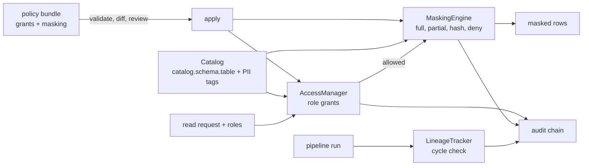

# Jagadish-data-governance

[](https://github.com/jagadishmazure-jpg/Jagadish-data-governance/actions/workflows/ci.yml)
[](https://github.com/jagadishmazure-jpg/Jagadish-data-governance/actions/workflows/codeql.yml)


**Data governance as code: a three-level catalog with PII tags, role grants, column masking with keyed pseudonyms, lineage with cycle detection, reviewable policy bundles and a hash-chained audit log. Vendor-neutral and offline.**

> Personal learning and portfolio project. Everything runs offline on synthetic,
> fictional data with no API keys. Nothing is deployed. Numbers in this README
> come from real runs and are re-checked by CI (`scripts/render_docs.py --check`).

## Recruiter summary

- Implements the core of a governed data platform in plain Python: catalog, grants, masking per role, lineage, policy diffs for review and an audit chain.
- Real run: an analyst is denied until granted, then sees `a***@***`; a data scientist sees `hmac:v1:93d978488f10eafe`; an intern does not see the column; a lineage cycle is rejected; a policy change is shown as a diff before it is applied.
- Pseudonyms are keyed HMAC-SHA256 with a key from the environment and a key id in the token; masking fails closed with no key. Rotation is documented.

## Purpose

AI agents that query company data need governance underneath them: who can
read which table, which columns are masked for whom, where a table's data
came from, and a record of every change. Commercial catalogs do this, but I
wanted to know the mechanics well enough to explain and test them, so this
repo builds the concepts without tying them to any vendor.

## Architecture



## How it works

**Catalog** (`datagov/catalog.py`): tables named `catalog.schema.table`, with
owner, columns and PII tags.

**Access** (`datagov/access.py`): grants of `read` or `write` per role and
table. `check()` returns (allowed, code, reason), and the code is audited.

**Masking** (`datagov/masking.py`): per column and role, one of `full`,
`partial`, `hash` (keyed HMAC-SHA256, output `hmac:<key id>:<16 hex>`) or
`deny` (column removed). The key comes from `DATAGOV_PSEUDONYM_KEY`; no key
means a `MaskingError`, not a plain hash.

**Lineage** (`datagov/lineage.py`): pipelines record inputs and outputs;
a record that would create a cycle is refused.

**Policies** (`datagov/policies.py`): a bundle is validated against the
catalog, diffed against the current one for review, then applied.
Details and key rotation: [docs/governance-model.md](docs/governance-model.md).

## Real code and output

```python
"""Catalog, default-deny access, PII masking (incl. keyed pseudonyms),
lineage and a tamper-evident audit log, on synthetic tables."""
from datagov import AccessManager, AuditLog, Catalog, LineageTracker, MaskingEngine, PolicyBundle

audit = AuditLog()
cat = Catalog(audit_log=audit)
cat.register_table("prod", "sales", "customers", columns=["id", "name", "email", "region"],
                   owner="alice", pii_columns=["email"])
cat.register_table("prod", "sales", "orders", columns=["order_id", "customer_id", "amount"], owner="bob")
cat.register_table("prod", "mart", "daily", columns=["day", "revenue"], owner="bob")

am = AccessManager(cat, audit_log=audit)
print("analyst before grant:", am.check(["analyst"], "prod.sales.customers", "read", user_id="u1"))
am.grant("analyst", "prod.sales.customers", "read", granted_by="alice")
print("analyst after grant: ", am.check(["analyst"], "prod.sales.customers", "read", user_id="u1"))
print("analyst write:       ", am.check(["analyst"], "prod.sales.customers", "write", user_id="u1"))

# Demo key only. In real use: DATAGOV_PSEUDONYM_KEY from a secret store.
mask = MaskingEngine(cat, audit_log=audit, pseudonym_key="demo-key-not-a-secret-0001", key_id="v1")
mask.set_policy("prod.sales.customers", "email", "analyst", "partial")
mask.set_policy("prod.sales.customers", "email", "data_scientist", "hash")
rows = [{"id": 1, "name": "Ann", "email": "ann@example.com", "region": "west"}]
for role in ["analyst", "data_scientist", "intern"]:
    print(f"{role:15s}", mask.apply("prod.sales.customers", rows, role=role, user_id="u1"))

lin = LineageTracker(audit_log=audit)
lin.record("nightly_etl", inputs=["prod.sales.orders", "prod.sales.customers"], outputs=["prod.mart.daily"])
print("upstream of mart.daily:", sorted(lin.upstream("prod.mart.daily")))
try:
    lin.record("bad_loop", inputs=["prod.mart.daily"], outputs=["prod.sales.orders"])
except Exception as e:
    print("cycle rejected:", e)

old = {"grants": [{"role": "analyst", "table": "prod.sales.customers", "level": "read"}],
       "masking": [{"table": "prod.sales.customers", "column": "email", "role": "analyst", "policy": "partial"}],
       "lineage": []}
new = {"grants": [{"role": "analyst", "table": "prod.sales.customers", "level": "write"}],
       "masking": [{"table": "prod.sales.customers", "column": "email", "role": "analyst", "policy": "full"}],
       "lineage": []}
print("policy diff for review:", PolicyBundle.diff(old, new))
print("audit entries:", len(audit.entries()), "| chain intact:", audit.verify_chain())
```

Output of `python examples/demo.py` (real run, re-checked in CI):

<!-- run: python examples/demo.py -->
```text
analyst before grant: (False, 'ACC-DENY-00', "no grant covers 'read' for role(s) ['analyst']")
analyst after grant:  (True, 'ACC-GRANT-01', "grant covers 'read' for role(s) ['analyst']")
analyst write:        (False, 'ACC-DENY-00', "no grant covers 'write' for role(s) ['analyst']")
analyst         [{'id': 1, 'name': 'Ann', 'email': 'a***@***', 'region': 'west'}]
data_scientist  [{'id': 1, 'name': 'Ann', 'email': 'hmac:v1:93d978488f10eafe', 'region': 'west'}]
intern          [{'id': 1, 'name': 'Ann', 'region': 'west'}]
upstream of mart.daily: ['prod.sales.customers', 'prod.sales.orders']
cycle rejected: Recording bad_loop would create a lineage cycle: prod.sales.orders already (transitively) feeds prod.mart.daily
policy diff for review: {'grants_added': [], 'grants_removed': [], 'grants_changed': [{'role': 'analyst', 'table': 'prod.sales.customers', 'from': 'read', 'to': 'write'}], 'masking_changed': [{'table': 'prod.sales.customers', 'column': 'email', 'role': 'analyst', 'from': 'partial', 'to': 'full'}]}
audit entries: 11 | chain intact: True
```
<!-- /run -->

## How to run

```bash
git clone https://github.com/jagadishmazure-jpg/Jagadish-data-governance.git
cd Jagadish-data-governance
python -m pip install pytest      # no runtime dependencies
python -m pytest -q          # offline, no keys
python examples/demo.py
python scripts/render_docs.py --check   # documented output still matches
```

Test suite size (real collection, re-checked in CI):

<!-- run: python scripts/count_tests.py -->
```text
42 tests collected
```
<!-- /run -->

## Guardrails

- Default deny: no grant means no access, with a reason code.
- PII columns can be masked differently per role; `deny` removes the column entirely.
- Keyed pseudonyms; masking refuses to run without a key of at least 16 bytes.
- Lineage cycles are rejected at record time.
- Policy changes are diffed for review before they are applied, and every change is audited.

## Limitations

- In memory; nothing is persisted and there is no query engine, only row filtering in Python.
- Roles are strings; there is no identity provider or group sync.
- Partial masking is one simple rule (first character kept).
- Row-level security and attribute-based policies are not built.

## Built vs planned

| Capability | Status | Where |
|---|---|---|
| Catalog with PII tags | Built | `datagov/catalog.py` |
| Role grants and checks with reason codes | Built | `datagov/access.py` |
| Column masking with keyed pseudonyms | Built | `datagov/masking.py` |
| Lineage with cycle detection | Built | `datagov/lineage.py` |
| Policy bundles with diff and apply | Built | `datagov/policies.py` |
| Row-level security, ABAC | Planned | docs/implementation-guide.md |
| Persistent store and identity provider | Planned | not started |

## Threat model

| Threat | Mitigation in this repo | Status |
|---|---|---|
| Analyst reads raw PII | Per-role masking, default deny | Built |
| Pseudonyms reversed by hashing guesses | Keyed HMAC-SHA256, key from env, fail closed | Built |
| Unreviewed policy change widens access | Diff before apply; audit of every change | Built |
| Bad lineage hides a data source | Cycle detection; lineage recorded by pipelines | Built |
| Key leaked from environment | Key Vault and managed identity | Planned |

## Interview points

- Masking is per role and per column; `deny` is different from `hash` because a join on the column is still possible with hash.
- A review finding I fixed: the hash mode was a plain SHA-256, reversible for emails; now keyed HMAC with a key id, failing closed.
- Policy diffs make governance reviewable like code.

More, with likely follow-up questions: [docs/interview-points.md](docs/interview-points.md).

## Implementation guide

The step-by-step path from this offline build to an Azure deployment is in
[docs/implementation-guide.md](docs/implementation-guide.md). None of it has been
run; it is a plan.

## Related repositories

| Repo | How it relates |
|---|---|
| [Jagadish-data-lakehouse](https://github.com/jagadishmazure-jpg/Jagadish-data-lakehouse) | The table format these policies would govern |
| [Jagadish-pii-guard](https://github.com/jagadishmazure-jpg/Jagadish-pii-guard) | PII detection in free text, same keyed-pseudonym approach |
| [Jagadish-governed-data-agent](https://github.com/jagadishmazure-jpg/Jagadish-governed-data-agent) | An agent that queries through governed access |
| [Jagadish-ai-data-readiness](https://github.com/jagadishmazure-jpg/Jagadish-ai-data-readiness) | Assessing whether data is fit for AI use |

## Documentation

- [Governance model and key rotation](docs/governance-model.md)
- [Implementation guide (Azure)](docs/implementation-guide.md)
- [Interview points](docs/interview-points.md)
- [Security policy](SECURITY.md)

## Project layout

```
datagov/
  catalog.py   catalog.schema.table, owners, PII tags
  access.py    grants, checks, reason codes
  masking.py   full / partial / hash (HMAC) / deny
  lineage.py   pipelines, upstream/downstream, cycle check
  policies.py  bundles: validate, diff, apply
  audit.py     hash-chained audit log
examples/demo.py  the run shown above
tests/       offline pytest suite
```

## License

MIT, see [LICENSE](LICENSE). All data is synthetic; every organisation and person is fictional.
